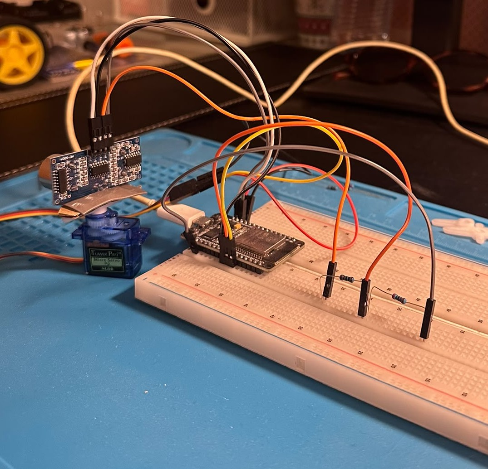

# ESP32-sonar-radar

Radar de proximidade com ESP32, sensor ultrassónico HC-SR04 e servo motor SG90 — varrimento angular com medição de distância, comunicação por porta série (115200 baud) e visualização em tempo real estilo radar militar com `pyqtgraph`.

## Objetivo

Este projeto dá continuidade à exploração de microcontroladores e sensores iniciada no projeto anterior, combinando um atuador (servo motor) com um sensor de distância ultrassónico para simular o funcionamento de um radar.

Os objetivos desta fase foram:
1. **Atuação:** Controlar um micro-servo SG90 para varrer um intervalo de ângulos de $0^\circ$ a $180^\circ$ (em vaivém).
2. **Sensing:** Em cada passo de $5^\circ$, medir a distância até a um obstáculo usando o sensor ultrassónico HC-SR04.
3. **Comunicação e Visualização:** Enviar os pares `ângulo,distância` pela porta série (`115200 baud`) e renderizar uma interface gráfica polar interativa em Python em tempo real.

---

## Componentes Utilizados

- **ESP32 DevKit (30 pinos)**
- **Sensor ultrassónico HC-SR04**
- **Micro servo motor SG90**
- **Resistores:** $1\text{ k}\Omega$ e $2\text{ k}\Omega$ (divisor de tensão para o pino Echo)
- **2x Breadboards standard** (juntas lado a lado para acomodar a largura do chip ESP32)
- **Cabos Jumper (Macho-Macho e Fêmea-Macho)**

---

## Estrutura do Repositório

```text
esp32-sonar-radar/
├── imagens/                       # Fotografias da montagem física
│   ├── Setup_Radar_1.jpeg         # Fotografia frontal da montagem física
│   └── Setup_Radar_2.jpeg         # Fotografia em perspetiva do radar
├── python/                        # Interface de visualização em Python
│   └── radar.py                   # Leitura da porta série e gráfico polar PyQtGraph
├── src/                           # Código principal C++ (PlatformIO)
│   ├── main.cpp                   # Lógica de varrimento e leitura ultrassónica
│   └── secrets.h                  # Credenciais de rede (não versionado)
├── platformio.ini                 # Configurações do ambiente de desenvolvimento
├── requirements.txt               # Dependências das bibliotecas Python
└── README.md                      # Documentação do repositório
```

---

## Esquema Elétrico e Pinagem

> **Nota de Proteção Elétrica:** O pino Echo do HC-SR04 envia sinais de $5\text{V}$, enquanto o ESP32 opera com lógica de $3.3\text{V}$. Foi utilizado um **divisor de tensão** ($1\text{ k}\Omega / 2\text{ k}\Omega$) para reduzir o sinal para $\sim 3.3\text{V}$ no GPIO 18, prevenindo danos ao microcontrolador.

| Componente | Pino do Componente | Ligação no ESP32 / Circuito | Função |
| :--- | :--- | :--- | :--- |
| **HC-SR04** | VCC | Pino **VIN** ($5\text{V}$) | Alimentação do sensor |
| | GND | Pino **GND** | Massa comum |
| | Trig | **GPIO 5** | Pulso de disparo ultrassónico |
| | Echo | Resistência $1\text{ k}\Omega \rightarrow$ **GPIO 18** $\rightarrow$ Resistência $2\text{ k}\Omega$ para GND | Sinal de retorno (com divisor $5\text{V} \rightarrow 3.3\text{V}$) |
| **Servo SG90** | Vermelho (VCC) | Pino **VIN** ($5\text{V}$) | Alimentação do motor |
| | Castanho/Preto (GND)| Pino **GND** | Massa comum |
| | Laranja/Amarelo (Sinal)| **GPIO 19** | Sinal de controlo PWM |

---

## Setup Físico

Devido à largura da placa ESP32 de 30 pinos, a montagem utilizou **duas breadboards encaixadas em paralelo**, permitindo acesso livre aos pinos de ambos os lados da placa. O sensor HC-SR04 foi fixado na extremidade do braço plástico (*horn*) do SG90 para acompanhamento rotativo.




---

## Como Correr

1. **Firmware (ESP32 / PlatformIO):**
   - Abrir o projeto no VS Code com a extensão PlatformIO.
   - Criar o ficheiro `src/secrets.h` com as credenciais (opcional se não usar WiFi):
     ```cpp
     #define WIFI_SSID "o_teu_ssid"
     #define WIFI_PASSWORD "a_tua_password"
     ```
   - Confirmar a biblioteca no `platformio.ini`:
     ```ini
     lib_deps = madhephaestus/ESP32Servo
     ```
   - Carregar o firmware para o ESP32 (`Upload`).

2. **Interface Gráfica (Python):**
   - Garantir a instalação das dependências:
     ```bash
     pip install -r requirements.txt
     ```
   - Fechar o Monitor Série da IDE (para libertar a porta COM).
   - Executar a visualização:
     ```bash
     python python/radar.py
     ```

---

## Resultados

A interface gráfica desenvolvida em `radar.py` renderiza um radar polar de tom verde néon estilo militar:
- **Feixe de Varrimento:** Acompanha sintonizadamente a rotação do servo de $0^\circ$ a $180^\circ$.
- **Deteção de Alvos:** Desenha pontos vermelhos em coordenadas cartesianas $(x, y)$ convertidas a partir das leituras polares $(r, \theta)$, identificando obstáculos com precisão no intervalo de $2\text{ cm}$ a $200\text{ cm}$.

---

## Conclusão

Esta fase permitiu consolidar a sincronização entre atuadores PWM (servo) e amostragem de sensores (ultrassónico), a adequação de níveis de voltagem entre periféricos de $5\text{V}$ e microcontroladores de $3.3\text{V}$, e o consumo de streams de dados da porta série em interfaces Python orientadas a eventos com `pyqtgraph`.

**Próximos passos:**
- Adicionar efeito de desvanecimento (*fade-out*) nos pontos para suavizar a varredura visual.
- Integrar buzzer/LED de alerta de proximidade para alvos a menos de $30\text{ cm}$.
- Exportar os dados de amostragem via MQTT para armazenamento em InfluxDB e visualização em Dashboard Grafana.

---

## Nota sobre o uso de IA

O código, a estrutura do projeto e a montagem física foram desenvolvidos e testados por mim. O assistente de IA Gemini (Google) foi utilizado como suporte técnico para:
- Validação do circuito elétrico e cálculo das resistências do divisor de tensão no pino Echo.
- Resolução de problemas práticos de montagem (utilização de duas breadboards para placas ESP32 de 30 pinos).
- Estruturação do script de visualização gráfica polar com a biblioteca `pyqtgraph` em Python.